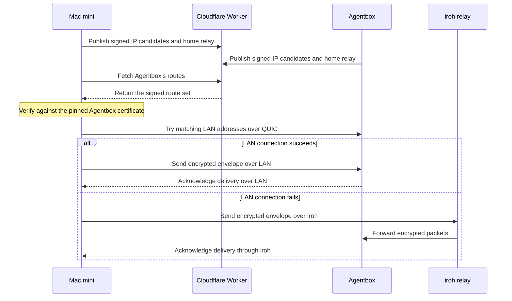

# Howl device discovery and iroh delivery

Approved devices use the Cloudflare control plane to find each other. Howl tries the local network first when an advertised peer address matches an active local subnet. If that attempt fails, iroh can deliver the same encrypted envelope through the peer's relay.

## Signed addresses and discovery

A signed route set contains up to eight IP and UDP port pairs, the device's current home relay when available, and issue and expiry times. The Ed25519 signature binds those fields to the device ID and its certificate fingerprint. Peers verify that signature against the certificate they already trust. The iroh connection also authenticates the peer's pinned endpoint ID. [Route format](../crates/howl/src/discovery.rs) · [Peer authentication](../crates/howl/src/transport.rs)

The Worker authenticates `POST /v2/discovery/hints` and `GET /v2/discovery/hints/{device}` with a signed request. It checks account membership before writing or reading the D1 route record. Devices cache the verified routes locally. They publish after an address or relay change, refresh unchanged routes hourly, and fetch known peers' routes about once a minute. A route set expires after 24 hours. The dashboard and older clients use the compatible single-address record. [Worker](../deploy/cloudflare-prototype/native-discovery.ts) · [Refresh loop](../crates/howl/src/network_client.rs)

## Path selection

For a fresh connection, Howl checks the advertised IPs against the prefixes of active local interfaces. Matching subnet candidates get 750 ms to establish a direct connection before iroh tries the full set of IP candidates and the relay. An automatically advertised address list skips Tailscale addresses. An explicit listen IP can still be advertised. Hosted devices enable iroh's default relay pool and accept advertised relays from their configured pool. iroh can move an established connection onto a working direct path when one becomes available. The device details page reports the selected path as **Direct** or **Relay**. [Howl dialing](../crates/howl/src/transport.rs) · [iroh path selection](https://docs.rs/iroh/1.5.0/iroh/endpoint/struct.Endpoint.html#method.connect)

## Encrypted delivery

Ordinary sends queue encrypted envelopes on the sender and deliver them over the iroh connection. The Worker stores discovery records and connection status. Offline mailbox storage in D1 is available when the network owner enables it and a device explicitly deposits an encrypted envelope. [Local send queue](../crates/howl/src/node.rs) · [Mailbox policy](../deploy/cloudflare-prototype/native-mailbox.ts)
